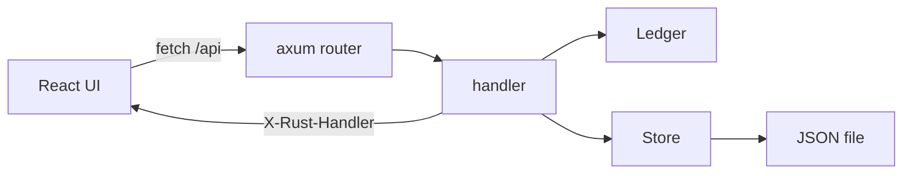

# spend

A small expense ledger with two doors into the same JSON file: a Rust CLI, and a React app that shows the Rust that handled each click.

Money is stored as integer cents. `12.50` is `1250`. Floats never enter the total.

## Quick start

You need Rust stable (1.85 or newer; this repo pins `stable` in `rust-toolchain.toml`) and Node 20 or newer.

```bash
make dev
```

That generates the teaching source map, starts the API at <http://127.0.0.1:8080>, and starts the UI at <http://127.0.0.1:5173>. Vite proxies `/api` to the Rust server. The CLI and the server both use `~/.spend.json` unless you pass `--file`.

Other commands:

```bash
make test    # cargo test --workspace and the Vitest suite
make lint    # fmt, clippy -D warnings, eslint, tsc
make build   # Vite build, then a release binary with the UI embedded
./target/release/spend serve
```

`spend serve` without `--dev` serves the API and the built UI on <http://127.0.0.1:8080>.

## Why four crates

| Crate | Role |
| --- | --- |
| `spend-core` | Types and ledger math. No files, no HTTP, no clock. |
| `spend-store` | The `Store` trait, a JSON file, and an in-memory store for tests. |
| `spend-api` | Axum routes, errors, and the `X-Rust-*` teaching headers. |
| `spend` | The CLI and `serve`. The only `main`. |

Core can be tested without a socket. The API depends on the `Store` trait, so tests use `MemoryStore` and the CLI uses `JsonFileStore`. The same methods run either way.



## Teaching headers

Every API response sets:

- `X-Rust-Handler` — the function name, such as `create_expense`
- `X-Rust-Concepts` — concept ids from `web/src/learn/concepts.ts`

`--dev` turns on CORS for `http://localhost:5173` and `http://127.0.0.1:5173`, and exposes those headers. The right-hand panel reads them, then shows the handler and the `Ledger` method it calls. `make gen` extracts that source with `syn`.

Lines marked `// LEARN(concept-id):` are the first plain-English note for that idea. Click one in the panel to open the glossary card.

## CLI

Amounts are decimal strings. `450` means 450.00. `12.50` means 12.50.

```bash
spend add 12.50 food --note "lunch" --date 2026-10-14
spend list --category food --month 2026-10 --search lunch
spend total --month 2026-10
spend report --month 2026-10
spend remove 1
spend budget set food 150.00
spend serve --addr 127.0.0.1:8080 --file ~/.spend.json --dev
```

Errors go to stderr as `error: ...` and the process exits 1.

## HTTP

Amounts in JSON are strings. Responses include `amount` (cents) and `display`.

```bash
curl -sS http://127.0.0.1:8080/api/health

curl -sS -X POST http://127.0.0.1:8080/api/expenses \
  -H 'content-type: application/json' \
  -d '{"amount":"12.50","category":"food","note":"lunch","date":"2026-10-14"}'

curl -sS 'http://127.0.0.1:8080/api/expenses?category=food&month=2026-10&search=lunch'

curl -sS http://127.0.0.1:8080/api/expenses/1

curl -sS -X DELETE http://127.0.0.1:8080/api/expenses/1

curl -sS 'http://127.0.0.1:8080/api/summary?month=2026-10'

curl -sS -X PUT http://127.0.0.1:8080/api/budgets/food \
  -H 'content-type: application/json' \
  -d '{"amount":"150.00"}'
```

`PUT /api/budgets/{category}` may take `?month=YYYY-MM`. Without it, the returned budget status uses the current month. A missing id is 404. A bad amount, category, or date is 400 with `{"error":"..."}`.

## Exercises

1. **Edit an expense.** Add `PATCH /api/expenses/{id}` that changes the note and amount. Reuse `Money::parse` and return the updated row.
2. **Recurring expenses.** Add a `repeats: Option<String>` field (`monthly`) and a method that copies last month's rows into this month.
3. **CSV import and export.** Implement `Store` again as `CsvStore` with `load` and `save`. The API should not need to change.
4. **Multi-currency.** Add a `Currency` enum and stop treating every integer as the same minor unit. Keep parsing free of floats.
5. **SQLite.** Add a `SqliteStore` with `rusqlite` that implements `Store`. `AppState` already holds `Box<dyn Store>`.

## Layout

`web/src/learn/rustSources.ts` and `usedIn.ts` are generated. Edit the Rust, then run `make gen`. Compiler-error snippets live in `web/src/learn/compilerErrors.json`; `cargo test -p spend-core --test compiler_errors` compiles each one with `rustc` and checks the error code.
